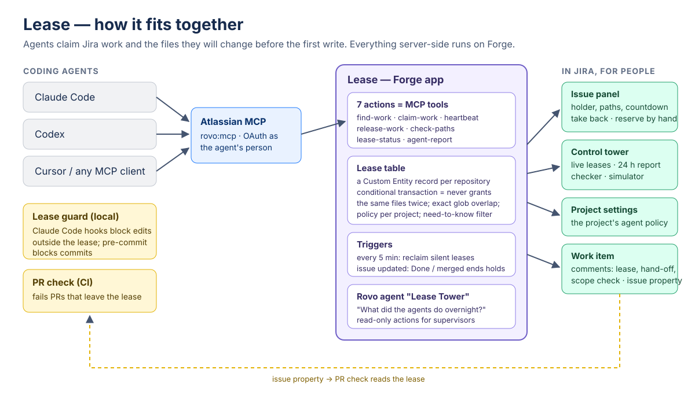

# Lease — air-traffic control for AI coding agents in Jira

Teams now run several coding agents at once: Claude Code on one laptop, Codex in the
cloud, Cursor on another, each in its own branch or sandbox. They read the same Jira
backlog and change the same codebase. Nothing stops two of them from rewriting the same
module for two different tickets, or an agent from taking a ticket a colleague started this
morning. You find out at merge time, after the tokens and the review hours are spent.

**Lease** is an Atlassian Forge app that makes every agent *claim* its Jira work item, and
name the files it will change, before its first write. A claim is refused when it would
collide with another agent, with a person working on those files, or with a path only
people may change. Claims expire unless the agent keeps sending heartbeats, so a crashed
agent never blocks the backlog. People see who holds what in Jira, reserve the files they
are changing by hand, take work back with one click, and get a morning report.

```
 Claude Code ─┐                        ┌─ Jira issue panel: who holds this, paths, progress, take back, reserve
 Codex ───────┼─ Atlassian MCP ── Lease ┼─ Control tower page: live leases, refusals, policy, simulator
 Cursor ──────┘   (rovo:mcp)     (Forge) └─ Rovo agent "Lease Tower": "what did agents do overnight?"
      │
      └─ Lease guard (local hooks): edits and commits outside the lease are blocked
```



## Why not just worktrees, the assignee field or CODEOWNERS?

| | What it does | What it misses |
|---|---|---|
| Git worktrees / sandboxes | Agents don't overwrite each other's files on disk. | Two branches rewriting `src/auth` still collide, at merge time, after the work is done. |
| Jira assignee | One person per ticket. | An agent working *for* Yu is not Yu; it says nothing about files; it never expires when the agent crashes. |
| CODEOWNERS / branch protection | Review after the change. | Lease acts before the first write, when changing course is free. |

Lease uses all three as they are, and adds the missing piece: **which files each agent
and person is changing right now, in the tool where the work is planned.**

## Isn't this file locking, which teams abandoned years ago?

Exclusive checkouts failed because they were coarse, manual and permanent: whole files locked
by default, for days, by people who forgot. Lease is the opposite on each count. Agents explore
read-only first and claim the smallest paths they will change; shared files (`package.json`,
lockfiles, barrel files) never block; a lease lasts 30 minutes unless the agent keeps working;
a handed-off pull request keeps only the exact files it changed; and a project can switch to
*warn* mode, where overlapping agents are told about each other instead of refused. What stays
strict is what should: people's work, protected paths, and work in progress.

**No deadlocks.** Lease never makes anyone wait: a claim or a widening is answered at once,
granted or refused with a reason. An agent that cannot widen its lease narrows its change,
hands the work back, or tells its person; it never sits holding one folder while waiting for
another.

## What it does

| | |
|---|---|
| **Claim before the first write** | `claim-work` grants a lease on a work item for named paths (`src/auth/**, tests/auth`). |
| **No collisions** | Two claims collide when any file could match both path patterns. The check is exact for `*`, `?`, `**` and folder prefixes, per repository (HTTPS, SSH and `owner/name` forms are the same repository). |
| **People first** | Agents only get work a person marked safe (label `agent-ok`), never work a person has *In Progress*, and never protected paths (`**/migrations/**`, `infra/**`, CI workflows by default). Folder claims are granted with the protected parts listed as `mustNotTouch`. |
| **People reserve files too** | Working on something by hand? Reserve its folders from the Jira panel for up to 8 hours, and agents on *other* work items are refused those paths, with your name. |
| **Shared files don't serialize the team** | `package.json`, lockfiles, barrel `index.ts` files and the like (configurable) never block each other: claims on them are granted with a note to keep changes additive so git can merge them. |
| **Enforced locally** | The Lease guard (`skill/install.sh`) adds Claude Code hooks and a git pre-commit hook: granted leases are recorded automatically from the MCP results, and edits or commits outside them are blocked with the exact next step. No tokens, no network. Each git worktree keeps its own lease state. |
| **Enforced in CI** | For cloud agents with no local hooks: `skill/ci/lease-pr-check.mjs` (GitHub Actions and Bitbucket Pipelines snippets included) reads the work item's lease from Jira and fails a pull request that changes files outside it, or whose lease a person revoked. |
| **Leases expire** | 30 minutes without a heartbeat (configurable) and the work returns to the queue, with a comment and the agent's last progress note. A scheduled trigger sweeps every 5 minutes; every read also ignores expired leases. |
| **Take it back** | Anyone who can edit the work item can revoke an agent's lease. The panel shows *Stopping…* until the agent hears about it on its next call, then tells the agent who took the work back and why. |
| **Held until merged** | When an agent hands off a pull request, the files it changed stay reserved until the work item is Done or reaches a status the project marks as merged (e.g. *In QA*), for at most 24 h by default, so the next agent doesn't build a conflicting change against `main` while the PR waits for review. Others are pointed at the PR to build on; the same person's agent can re-claim to address review comments. |
| **Scope check on hand-off** | `release-work` posts the outcome, summary and PR on the work item, and checks the changed files against the lease: files outside it, or in protected paths, are called out. |
| **Jira stays the truth** | Moving a work item to Done ends its lease. A person starting leased work is flagged on the work item, once. Leases are mirrored to an issue property (`issue.property[lease].held = true` works in JQL), which keeps the last lease's paths after it ends so CI can check the pull request. |
| **Morning report** | `agent-report` and the Lease Tower Rovo agent: finished work with PRs, what needs a person (blocked, handed back, expired), collisions prevented. |
| **Need to know** | Leases are stored app-wide, but every answer is filtered by what the asking person can see: for work items in projects they cannot open, agents and pages learn only which paths are taken, never the key, summary, plan or pull request. |
| **Per-project policy** | In each project's settings (and the control tower), admins set the label, default repository, leases per agent, lease length, protected and shared paths, the hold-until-merged rule, block or warn on agent overlaps, and whether in-progress human work is off limits. |
| **Try it without an agent** | The control tower can add sample work items and run two simulated agents through the real claim code. |

## How it is built

* **Forge, nothing else.** No external services, no API keys, no egress.
* **`rovo:mcp`** exposes 7 actions as MCP tools (`find-work`, `claim-work`, `heartbeat`,
  `release-work`, `check-paths`, `lease-status`, `agent-report`) at
  `https://mcp.atlassian.com/forge/253f3343-f9f7-49af-adf0-e4b3358cc935`. Any MCP client connects with OAuth and acts
  with **its person's own Jira permissions** (reads run `asUser`; the account ID comes from
  the invocation context, never from model-supplied input).
* **`rovo:agent`** "Lease Tower" for the people supervising agents (read-only actions).
* **UI Kit**: `jira:issuePanel`, `jira:globalPage` and `jira:projectSettingsPage`.
* **Triggers**: `scheduledTrigger` (every 5 minutes) reclaims silent leases;
  `avi:jira:updated:issue` keeps leases in step with Jira.
* **A lease table that cannot double-grant.** All active leases live in one Custom Entity
  record with a revision number. Each change reads it (strictly consistent), decides with
  pure functions (`src/core/leases.js`), and commits with a conditional transaction on the
  revision; if another agent committed first, it re-reads and decides again. The first write
  uses `FAIL_IF_EXISTS`. One record keeps every grant linearizable across repositories and
  people. A lease takes about 490 bytes, so the 200 KiB budget (under the 240 KiB entity limit)
  holds about 400 active leases and pull-request holds per site; past that, claims are refused
  with a clear message. Contention is low in practice: 400 agents heart-beating every 10 minutes
  is about 40 writes a minute, and a conflicting write costs one re-read. Sharding per repository is
  the next step for very large sites.
* **Skill, guard and CI check**: [`skill/SKILL.md`](skill/SKILL.md) teaches the protocol;
  [`skill/install.sh`](skill/install.sh) installs the local guard;
  [`skill/ci/`](skill/ci/) checks pull requests against the lease.

## Tests

```bash
npm install
npm test          # 70 tests, offline, about 3 seconds
```

* `test/paths.test.js`: glob overlap, including a brute-force oracle over 600 random pattern pairs.
* `test/leases.test.js`: every policy rule, person reservations, scope checks, expiry, revoke,
  repository name forms, the site cap, and **12 agents racing for the same paths through the
  real store code: exactly one wins**; 6 racing on disjoint paths: all win, no lost update.
* `test/e2e.test.js`: the deployed entry points (`src/index.js`) against an in-memory Jira and
  KVS, including revocation hand-shake, reservations, scope check comments and the simulator.
* `test/hooks.test.js`: the guard as real processes in a throwaway git repository: install,
  blocked and allowed edits, `mustNotTouch`, pre-commit refusal, bypass, expiry.
* `test/ci.test.js`: the pull request check: inside, outside, protected, revoked, missing lease,
  other repository, step summary.

Mutation check: removing the revision condition, the collision check, the human-in-progress
rule, expiry, glob matching or the owner check each turns tests red.

## Install and try

See [JUDGES.md](JUDGES.md) for the installation link and a 10-minute walkthrough.

```bash
npm install -g @forge/cli          # Node 22 or 24
forge register && forge deploy && forge install --product jira
```

Connect an agent (after a site admin enables the Lease tools under Atlassian Administration →
Apps → Sites → *site* → Connected apps), then install the guard in your repository:

```bash
claude mcp add --transport http lease https://mcp.atlassian.com/forge/253f3343-f9f7-49af-adf0-e4b3358cc935
sh /path/to/lease/skill/install.sh
```

## Privacy

Lease stores, in Forge storage on your site: active leases (work item key and summary, agent
name, the person's account ID and display name, paths, plan, progress notes), finished-lease
history for 90 days, events for 30 days and revocation notices for 2 days. It makes no
external calls. The local guard keeps `.lease/active.json` in your checkout (git-ignored).

## License

MIT
